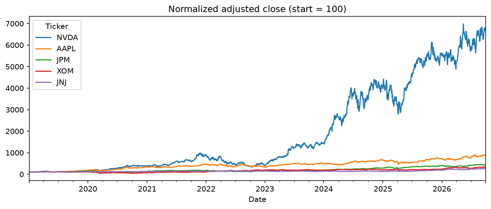
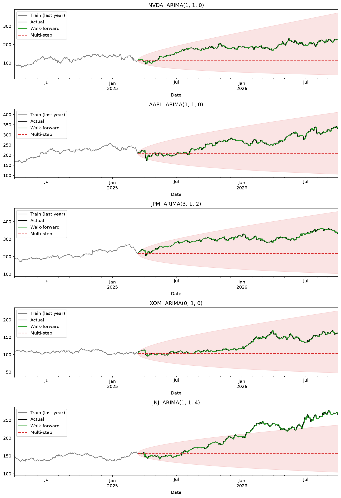

# Stock Market Analysis and Prediction: Can ARIMA Beat a Naive Baseline?

## Project Description

This project tests whether an ARIMA time-series model can forecast daily closing prices of five large-cap U.S. stocks better than a naive "tomorrow = today" benchmark. The stocks span five sectors: NVIDIA (technology), Apple (consumer technology), JPMorgan Chase (financials), ExxonMobil (energy), and Johnson & Johnson (healthcare).

The analysis uses daily adjusted close prices from January 2019 to October 2026. The final 20% of observations is held out as a test window, and models are judged only on data they have not seen.

**Key findings**

- ARIMA does not significantly beat the naive baseline on any of the five stocks. For NVDA and AAPL the difference is not statistically significant (Diebold-Mariano p-values of 0.62 and 0.15).
- For XOM, the selected model is ARIMA(0,1,0), which is the random-walk (naive) model itself, so the forecasts are identical.
- For JNJ and JPM, the more complex models, ARIMA(1,1,4) and ARIMA(3,1,2), are significantly worse than the naive baseline (p = 0.0002 and 0.048), a sign of overfitting. The JPM result is borderline.
- Directional accuracy is close to a coin flip (48.6% to 51.6%) and below a simple "always predict up" strategy on every stock with a defined result.
- Multi-step forecasts degrade quickly: RMSE is roughly 14 to 24 times larger than one-step-ahead RMSE, and the forecast flattens into a near-constant line.
- Ljung-Box tests reject white-noise residuals for four of five stocks, which points to remaining structure in volatility rather than in price direction.

These results are consistent with weak-form market efficiency: past prices carry little exploitable information for forecasting future price levels or direction.

### Results Summary

Walk-forward (one-step-ahead) performance on the held-out test window. RMSE is in dollars, so it is comparable only within a stock.

| Stock | ARIMA order | ARIMA RMSE | Naive RMSE | Diebold-Mariano p-value | Verdict | ARIMA direction accuracy | "Always up" benchmark |
|---|---|---|---|---|---|---|---|
| NVDA | (1,1,0) | 4.241 | 4.252 | 0.616 | No significant difference | 51.6% | 52.7% |
| AAPL | (1,1,0) | 4.562 | 4.515 | 0.153 | No significant difference | 49.7% | 54.0% |
| JPM | (3,1,2) | 4.283 | 4.203 | 0.048 | Naive significantly better | 51.3% | 56.4% |
| XOM | (0,1,0) | 2.134 | 2.134 | n/a | Identical forecasts | n/a | 55.9% |
| JNJ | (1,1,4) | 2.626 | 2.546 | 0.0002 | Naive significantly better | 48.6% | 54.8% |

XOM's selected model forecasts no change from the prior day, so it makes no up or down call and has no directional accuracy.

### Results at a Glance

*Adjusted close prices indexed to 100 at the start of the sample, showing the five stocks' very different growth paths.*

*Forecasts versus actual prices on the held-out test window. The walk-forward forecast (green) tracks the actual price closely because each day's forecast uses the prior day's value. The multi-step forecast (red dashed) flattens into a near-constant line, and its 95% band widens with the horizon.*

## Architecture

The analysis is a single linear pipeline in one Jupyter notebook, `stock_arima_analysis.ipynb`.

1. **Data acquisition.** Daily OHLCV data for NVDA, AAPL, JPM, XOM, and JNJ is pulled from Yahoo Finance through `yfinance`, with splits and dividends adjusted.
2. **Data preparation.** Prices are aligned to a business-day calendar, gaps are forward-filled, and log prices and log returns are computed.
3. **Exploratory analysis.** Normalized price comparison, 50/200-day moving averages, 30-day rolling volatility, a return-correlation heatmap, trend/seasonality decomposition, and summary statistics.
4. **Stationarity testing.** Augmented Dickey-Fuller tests on log prices and log returns establish one order of differencing (d = 1).
5. **Chronological split.** The first 80% of observations is used for training and the last 20% for testing. Data is never shuffled.
6. **Model selection.** ACF and PACF plots guide the choice of AR and MA terms. `auto_arima` then selects the order for each stock by AIC using training data only.
7. **Forecasting.** Two forecast modes are produced for each stock:
   - **Walk-forward (one-step-ahead):** each day's forecast uses all data up to the prior day.
   - **Multi-step:** one forecast over the whole test window, with 95% confidence intervals.
8. **Evaluation.** RMSE, MAE, and MAPE against the naive baseline, plus residual diagnostics (Ljung-Box).
9. **Statistical comparison.** Diebold-Mariano tests (with the Harvey-Leybourne-Newbold small-sample correction) check whether ARIMA and naive errors differ significantly.
10. **Directional accuracy.** The share of up/down days called correctly, tested against a 50% coin flip and compared with an "always up" benchmark.

## Repository Contents

| Path | Description |
|---|---|
| `stock_arima_analysis.ipynb` | Full analysis with code, charts, and outputs |
| `images/` | Charts displayed in this README |
| `results/model_results.csv` | RMSE, MAE, and MAPE for every stock and model |
| `results/dm_test_results.csv` | Diebold-Mariano test results |
| `results/directional_accuracy.csv` | Directional accuracy results |
| `results/evaluation_summary.csv` | Combined statistical evaluation |
| `requirements.txt` | Python dependencies |

## Tech Stack

Python, pandas, NumPy, yfinance, statsmodels, pmdarima, scikit-learn, SciPy, Matplotlib
